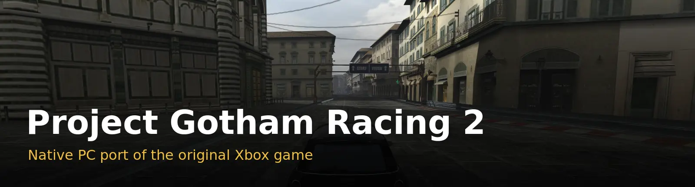
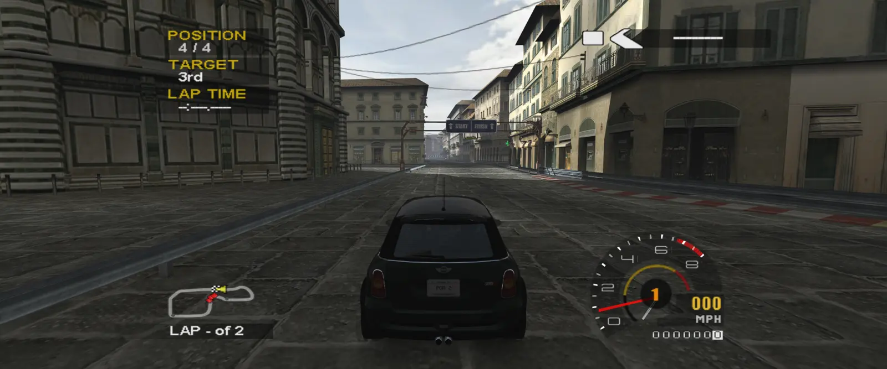
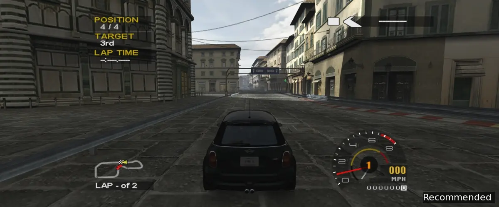
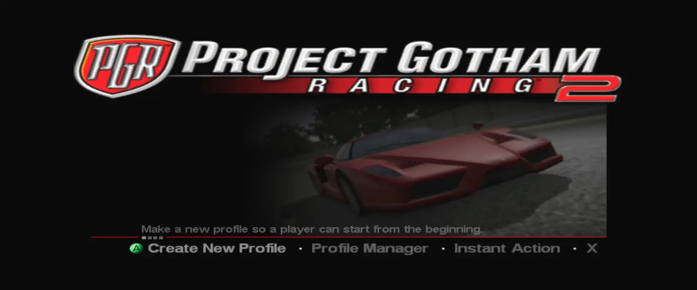
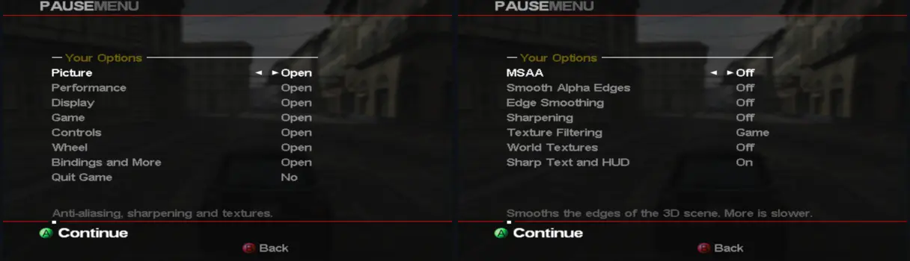
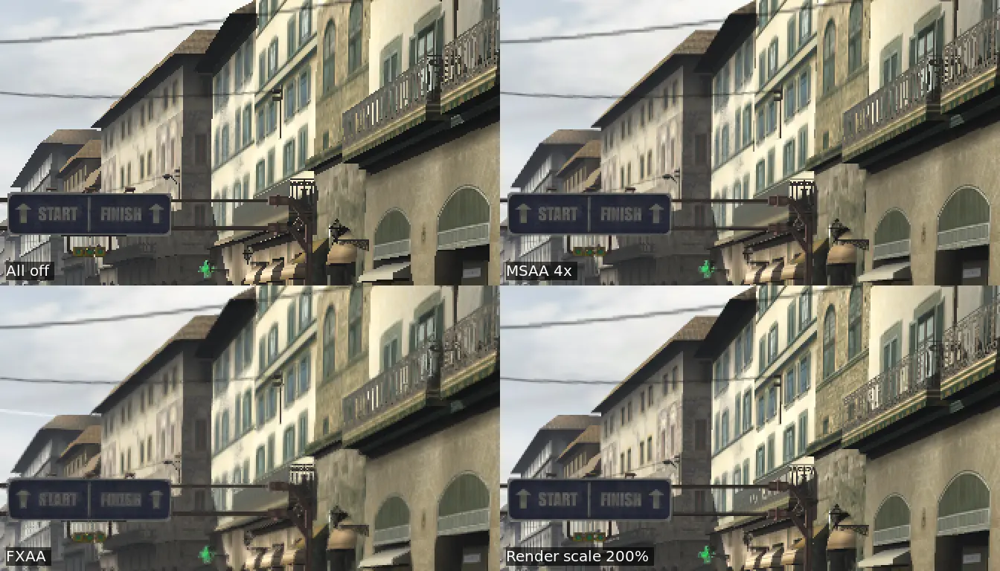
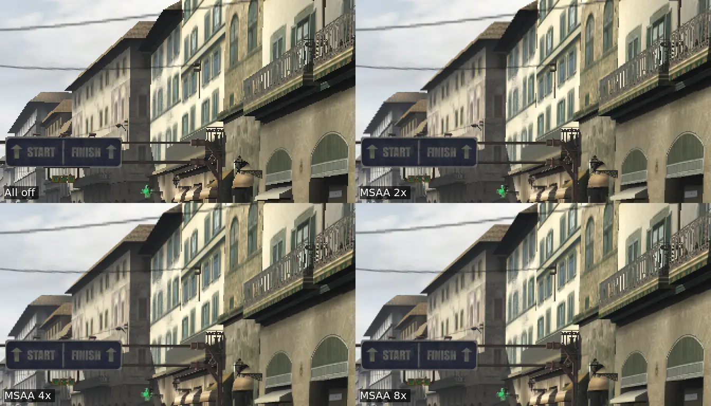
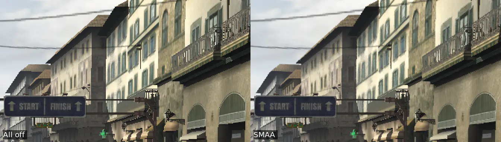
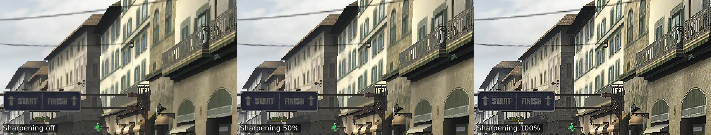
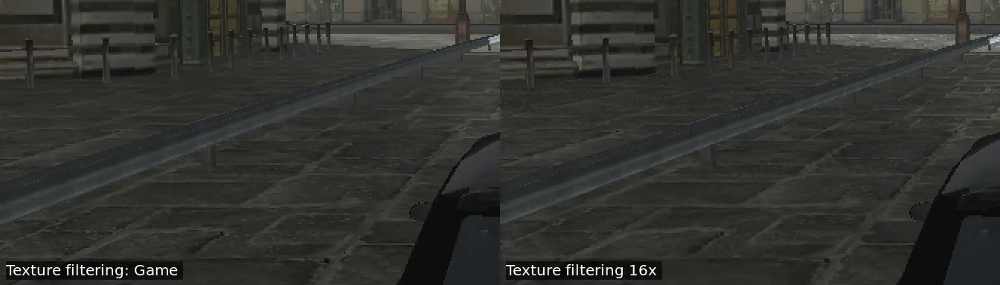

<p align="center">
  
</p>

<p align="center">
  
  
  
  <a href="https://github.com/hk21x/pgr2-recomp/releases/latest"></a>
</p>

<p align="center">
  <a href="#getting-started"><b>Getting started</b></a> &nbsp;·&nbsp;
  <a href="#building"><b>Building</b></a> &nbsp;·&nbsp;
  <a href="https://discord.gg/PQjkKsdtc"><b>Discord</b></a>
</p>

<p align="center">
  
</p>

**The 2003 Xbox street racer, running natively on PC.** This is not an emulator. The game's own x86 code is
statically recompiled with the [Xbox XBE Recomp](https://github.com/TGP482/XboxXBE-Recomp) toolkit into a Windows
program, with the Xbox's graphics, sound and system libraries rebuilt underneath (Direct3D 12 or 11, XAudio2, SDL):
widescreen and ultrawide, races at up to 144 frames a second, sharper graphics, keyboard, modern pads and steering
wheels, your own music, achievements, and settings inside the game's own menus.

> [!NOTE]
> This project does not include any game assets. You need your own copy of the Xbox game to play: the launcher
> builds the game's code on your PC from your disc.

## Table of contents

- [Xbox vs. PC](#xbox-vs-pc)
- [Features](#features)
- [Widescreen and ultrawide](#widescreen-and-ultrawide)
- [Recomp: settings in the game's menus](#recomp-settings-in-the-games-menus)
- [Graphics settings](#graphics-settings)
- [Controls](#controls)
- [Your music, DLC and system link](#your-music-dlc-and-system-link)
- [Achievements](#achievements)
- [Requirements](#requirements)
- [Getting started](#getting-started)
- [FAQ](#faq)
- [Known issues](#known-issues)
- [Roadmap](#roadmap)
- [Community and support](#community-and-support)
- [Building](#building)
- [Credits and legal](#credits-and-legal)

## Xbox vs. PC
<sup>[(Back to top)](#table-of-contents)</sup>

<p align="center">
  
  <br>
  <i>All extras off vs. render scale 200%, MSAA 4x, smooth alpha edges, texture filtering 16x and sharpening 50%, at 1920x800 (21:9).</i>
</p>

The Xbox drew PGR2 at 640x480, at 4:3 or in its own 16:9 mode for a widescreen TV, with races at 30 frames a second.
The port draws it at your screen's resolution and shape, with races at 30 as on the console or at up to 144, and with
anti-aliasing, sharpening and texture filtering on top of the game's own picture.

## Features
<sup>[(Back to top)](#table-of-contents)</sup>

| | |
|---|---|
| **Widescreen and ultrawide** | The game's own 16:9 mode on a 16:9 screen. At 21:9 and wider the 3D views are widened to the screen at full sharpness, with the HUD and menus in a centred 16:9 area. 16:10 and 3:2 screens are filled too. |
| **High frame rate races** | Race Frame Rate 30 (the console's, and the default), 60, 90, 120 or 144, with the same physics. Menus run at 60. |
| **Sharper graphics** | Render scale from 25% to 200%, MSAA up to 8x, FXAA or SMAA, sharpening, texture filtering up to 16x, smooth alpha edges and sharp text and HUD. |
| **Recomp in the game's menus** | Options > General Options > Recomp, or the pause menu in a race: every setting in the game's own option rows. Everything is also in the F1 window and `pgr2.toml`. |
| **Controllers and wheels** | Xbox, PlayStation and Switch pads with hot plugging and rumble. Any DirectInput wheel, pedals, shifter or button box, with force feedback and H-pattern shifters. |
| **Keyboard and mouse** | The keyboard plays as controller 1, two keys for each input, remappable. Mouse look on the right stick. |
| **Your music** | PGR2's custom soundtracks from your own MP3, FLAC, OGG, M4A or WAV files, converted by the launcher. |
| **Xbox Live DLC** (experimental) | Paris, Long Beach and the 16 DLC cars, from your own booster pack and title update files. |
| **System link** | On the LAN, or straight to a friend's IP address. |
| **Achievements** | 64, with pop-ups and a list in the settings window. |
| **The launcher** | Choose your disc, get the game ready, play. It builds the game's code from your disc in seconds, and updates itself and the game, keeping your saves. |
| **Quality of life** | Skip intro, hide the HUD, field of view, draw distance, F12 screenshots at full resolution, Alt+Enter for full screen, pause in the background, eight languages. |

## Widescreen and ultrawide
<sup>[(Back to top)](#table-of-contents)</sup>

<p align="center">
  
  <br>
  <i>The title menu at 1920x800 (21:9). The race shots above show the 3D view widened, with the HUD kept in the middle.</i>
</p>

**Aspect Ratio** chooses the picture's shape:
- **From Screen** (the default) follows your screen: the game's own 16:9 mode on a 16:9 screen, with its wider view
  and the HUD at the edges; at 21:9 and wider, the race and replay cameras widened to the screen at full sharpness,
  with the HUD and menus kept in a centred 16:9 area; on 16:10 and 3:2 screens, the game's 4:3 mode with its 3D
  widened to the screen.
- **4:3** and **16:9** fix the shape; **Fill Screen** widens to any screen.

The menus' backdrop movie fills the screen's width; the intro movies keep their 4:3 shape. Ultrawide has been played
on 21:9 and 32:9 screens, the rear view mirror and replays included.

## Recomp: settings in the game's menus
<sup>[(Back to top)](#table-of-contents)</sup>

<p align="center">
  
  <br>
  <i>Recomp in a race's pause menu: the sections, and Picture.</i>
</p>

**Options > General Options > Recomp** (where the console had Screen Center), or **Recomp** in the pause menu of a
race, holds every setting of this PC version in the game's own option rows, changed with left and right and saved at
once.

| Section | Settings |
|---|---|
| **Picture** | MSAA, smooth alpha edges, edge smoothing (FXAA, SMAA), sharpening, texture filtering, world textures, sharp text and HUD |
| **Performance** | Render scale, scaling filter, frame rate cap, low latency, frame counter, renderer (Direct3D 12 or 11) |
| **Display** | Monitor, display mode (full screen, borderless, window), resolution, vertical sync, aspect ratio |
| **Game** | Race frame rate, draw distance, field of view, race HUD, skip intro, Xbox Live DLC, language, pause in background |
| **Controls** | Keyboard, mouse look, invert mouse, mouse sensitivity, default keys and controller |
| **Wheel** | Invert steering, wheel rotation, steering lock, dead zone, force feedback, road and impacts |

**Bindings and More** opens the settings window (also **F1**, or **Back + Start** on a pad): the same settings, plus
key, button and wheel bindings and the achievements list. Everything is saved in `pgr2.toml` beside the game.
**Quit Game** is at the bottom of Recomp.

## Graphics settings
<sup>[(Back to top)](#table-of-contents)</sup>

In Recomp > Picture and Performance, or the settings window (F1); they apply at once. These are shots of one frame
at 1920x800, taken one after another on an Intel Arc A750; the close-ups are enlarged twice.

<p align="center">
  
  <br>
  <i>Edges: all off, MSAA 4x, FXAA and render scale 200%.</i>
</p>

- **MSAA** smooths the edges of the 3D scene and keeps textures sharp. The more samples, the slower.

<p align="center">
  
  <br>
  <i>MSAA off, 2x, 4x and 8x.</i>
</p>

- **Edge smoothing** works on the finished frame, HUD included: FXAA softens it a little, SMAA keeps it crisper.

<p align="center">
  
  <br>
  <i>Edge smoothing off vs. SMAA.</i>
</p>

- **Render scale** draws the picture larger than the screen: the smoothest fine detail, and the slowest.
- **Sharpening** makes the picture crisper. Around 50% is a good start; 100% turns walls and roads gritty.

<p align="center">
  
  <br>
  <i>Sharpening off, 50% and 100%.</i>
</p>

- **Texture filtering** keeps the road sharp into the distance.

<p align="center">
  
  <br>
  <i>Texture filtering Game vs. 16x.</i>
</p>

- **Smooth alpha edges** softens leaves, fences and other cut-out shapes, which MSAA alone leaves jagged. It needs
  MSAA on.
- **Scaling filter** chooses how the frame reaches the screen when render scale is not 100%: Bilinear, or Sharp, a
  little crisper.
- **World textures** only smooths the texture's pixels and adds no detail, and it can cause hitches of a quarter of a
  second. Best left off.

A good start for a capable PC is the wipe's: render scale 200%, MSAA 4x, smooth alpha edges, texture filtering 16x
and sharpening 50%. On a slower graphics card, lower the render scale first.

## Controls
<sup>[(Back to top)](#table-of-contents)</sup>

| Xbox input | Keyboard | Modern pad |
|---|---|---|
| Steer, menus (left stick) | Arrow keys, or A / D | left stick |
| Accelerate / brake (triggers) | W / S | RT / LT |
| A / B | Enter or Space / Backspace | A / B |
| X / Y | Q / E | X / Y |
| Black / White | R / F | RB / LB |
| Start / Back | Esc or P / Tab | Start / Back (View) |
| D-pad | Numpad 8 / 2 / 4 / 6 | d-pad |
| Right stick, stick clicks | I J K L, C and V | right stick, stick clicks |
| Settings window | F1 | Back + Start |
| Screenshot | F12 | |
| Full screen | Alt+Enter | |

The keyboard plays as controller 1 while the game window has the focus. Keys and buttons can be changed in the F1
window's Controls tab, two keys for each input; any console input can be put on any pad input. Steering wheels are
set up in F1 > Wheel: click a control, then turn, press or move it.

## Your music, DLC and system link
<sup>[(Back to top)](#table-of-contents)</sup>

- **Your music:** the launcher's **Your music** page converts a folder of your own music (MP3, FLAC, OGG, M4A, WAV and
  more), each folder a soundtrack. In the game: Options > Sound / Music > PGR 2 Custom Soundtrack to build a playlist,
  then the Radio/CD options in a race's pause menu.
- **Xbox Live DLC** (experimental): Paris, Long Beach and the 16 DLC cars from your own booster pack and title update
  files (Recomp > Game, or F1 > Game). See [WINDOWS.md](WINDOWS.md).
- **System link:** races on the LAN as on the console. Over the internet, the joining player sets
  `join_ip = 'a.b.c.d'` (the host's address) in `pgr2.toml`; the host needs the game's port forwarded, or both players
  on one VPN. Xbox Live itself was shut down in 2010 and is not part of the port.

## Achievements
<sup>[(Back to top)](#table-of-contents)</sup>

64 achievements (780 points): the Kudos World Series and class medals, Arcade, Kudos ranks, the garage, speed, wins
and Geometry Wars, with a pop-up and a list in the settings window. Unlocks are kept in `achievements.toml` beside the
game. They are written in RetroAchievements' condition format; the set and its memory map are in
[ACHIEVEMENTS.md](ACHIEVEMENTS.md).

## Requirements
<sup>[(Back to top)](#table-of-contents)</sup>

- **Windows 10 or 11, 64 bit**, and a graphics card with Direct3D 12 or 11. Without Direct3D 12 the game starts on 11
  by itself.
- **Your own copy of the game:** an `.iso` image of your disc, or a folder with the disc's files. The European (PAL)
  and North American (NTSC) releases (title id 4D53004B) are supported:

  | Release | `default.xbe` SHA-1 |
  | --- | --- |
  | Europe (PAL), version 2 | `676895b86f01938804c5f1cdcad8b44044295cb4` |
  | North America (NTSC), version 5 | `ec6e902fc167de349f1dc1838a7441dfff932c62` |
  | Europe (PAL), media patched | `acd776330a9b903fd567b544cf7ece0f612f6c7d` |
  | North America (NTSC), media patched | `702b79fd3bc844a413cbc26404718b1bf7e44e87` |

  The executable is recompiled from the PAL file. The North American `default.xbe` differs from it only in its
  signature and certificate, so the same executable runs it. A media patched copy (made to run from a modded console's
  hard disk) changes one byte of start-up code that the port replaces anyway. The log (`logs\pgr2.log`) names the
  SHA-1 of the `default.xbe` it found. Any other release (the Japanese one, for example) has not been checked, and the
  game asks before starting it.
- **About 1 GB free**, plus room for your copy of the game, and an internet connection for the game's package (about
  70 MB).
- **Speed:** races at the console's 30 frames a second run on any recent PC. At 60, the busiest streets need a fast
  processor; above 60 they dip on most processors, and a variable refresh display (FreeSync, G-Sync) hides dips best.
  In replays the graphics card is the limit at render scale 200%.

## Getting started
<sup>[(Back to top)](#table-of-contents)</sup>

`PGR2Launcher.exe` does everything for you: no Visual Studio, no Git, no command line, nothing installed in Windows
and no admin rights needed. Both it and a build from source make the game's code on your own PC from your own disc:
it is never downloaded, only the program around it.

1. Download `PGR2Launcher.exe` from the [latest release](https://github.com/hk21x/pgr2-recomp/releases/latest).
2. Put it in a folder of its own with a short path (for example `C:\Games\PGR2`) and run it. Everything it makes goes
   in a `PGR2` folder beside it. Windows may warn about an unrecognised app: choose **More info**, then **Run anyway**.
3. **Your game:** choose your disc image or the folder with the disc's files. The launcher checks that it is a
   supported release.
4. **Get the game ready:** the launcher downloads the game's package (the program and a compiler, no game code), then
   your PC builds the game's code from your disc. That took about 20 seconds on a fast 16 thread PC. You can stop at
   any time; it carries on where it left off.
5. **Play.** The first start sets up the emulated hard disk and copies the game's cache while the intro movies play
   (about two minutes); later starts are quick.

When a new release is out, the launcher offers it at the top of its window: **Update the launcher**, then **Update**.
The new version is built beside the game and only replaces it once it is ready, keeping your saves, settings and music.

The launcher's pages: **Game** (your disc, the steps, Play), **Your music**, **Manage** (the install, its folders,
removing build files, building the game again if it will not start) and **Log**.

Files, all under the `PGR2` folder beside the launcher:
- `play\`: `PGR2.exe`, `PGR2.dll` (the game's code, built on your PC), `pgr2.toml` (settings), `hdd\` (profiles,
  saves, caches and your music), `logs\pgr2.log`, `achievements.toml`, `screenshots\`, `compiler\`
- `launcher.log`, the launcher's log (send it with any problem)
- `tools\ffmpeg`, only if you import your music

To remove everything, delete the launcher and its `PGR2` folder (keep `play\hdd` if you want your saves).

## FAQ
<sup>[(Back to top)](#table-of-contents)</sup>

<details>
<summary><b>Is this an emulator?</b></summary>
<br>
No. The game's x86 code is translated ahead of time into C++ and built as a Windows program. The Xbox's graphics,
sound and input are rebuilt for the PC underneath it. That is what makes ultrawide at full sharpness, races above 30
frames a second and settings inside the game's menus possible.
</details>

<details>
<summary><b>Why a recompilation?</b></summary>
<br>
PGR2 never came out on PC, so the Xbox game is the only one there is. Recompiling it gives:
<ul>
<li><b>The whole game to work with.</b> A feature is a change in source and in our own renderer: ultrawide with the
HUD kept in place, high frame rate races, and Recomp in the game's own menus were built that way.</li>
<li><b>One runtime for several games.</b> The renderer, anti-aliasing, controllers and wheels, achievements and the
settings window come from the toolkit this port shares with other Xbox ports, and a fix made for one reaches the
others.</li>
<li><b>A present-day program.</b> 64 bit and Direct3D 12, running at the speed of your PC rather than of an emulated
console.</li>
</ul>
</details>

<details>
<summary><b>Why do I need my own copy of the game?</b></summary>
<br>
The game belongs to its rights holders. This project shares only its own work: the game's code and assets are made
from your disc on your PC.
</details>

<details>
<summary><b>Can I play online?</b></summary>
<br>
Xbox Live for the original Xbox closed in 2010, so the game's Xbox Live mode has nothing to connect to. System link
works on a LAN, and over the internet with <code>join_ip</code>: see
<a href="#your-music-dlc-and-system-link">system link</a>.
</details>

<details>
<summary><b>Races dip below the frame rate I chose.</b></summary>
<br>
The limit is usually the processor, in the busiest streets; a draw distance above 100% adds to it. In replays it is
the graphics card: lower the render scale or MSAA. The console's 30 is the default.
</details>

<details>
<summary><b>Something is wrong. What should I send?</b></summary>
<br>
<ul>
<li>The first lines of <code>logs\pgr2.log</code> list the settings, the graphics card and any <code>XBE_*</code> or
<code>PGR2_*</code> environment variables; leftover ones from experiments change how the game draws.
<a href="WINDOWS.md">WINDOWS.md</a> lists the diagnostic switches.</li>
<li>The launcher's build failing: send <code>PGR2\launcher.log</code>. Press Build again after a network problem: it
carries on where it stopped.</li>
<li>The build stopping while it unpacks the Windows SDK (the last lines <code>extracting ... .msi</code>): the
launcher's folder path is too long for Microsoft's installer. Move the launcher and its <code>PGR2</code> folder to a
short folder such as <code>C:\Games\PGR2</code> and press Build again.</li>
<li>"Another release" in the log, or the game not starting: the <code>default.xbe</code> is not one of the supported
releases.</li>
<li>A crash: the dump in <code>CrashDumps</code> includes the game's memory. Dumps are about 300 MB: zip one and share
it through a file host.</li>
<li>A first boot again (the cache, the intro movies): delete the <code>hdd</code> folder beside <code>PGR2.exe</code>.</li>
</ul>
Report problems on the <a href="https://github.com/hk21x/pgr2-recomp/issues">issue tracker</a> or the
<a href="https://discord.gg/PQjkKsdtc">Discord server</a>.
</details>

## Known issues
<sup>[(Back to top)](#table-of-contents)</sup>

- **Sound effects:** reverb and filters are not modelled, so some effects sound drier than on the console.
- **Races above 30** can dip in the busiest streets on most processors (see [Requirements](#requirements)).
- **Xbox Live DLC** is experimental: a few objects are left out, and some day sets show at night.
- **Draw distance** above 100% is experimental: most streets end before the console's distance.
- **World textures** only smooth the texture's pixels and can cause hitches of a quarter of a second. Best left off.
- Open reports are on the [issue tracker](https://github.com/hk21x/pgr2-recomp/issues).

## Roadmap
<sup>[(Back to top)](#table-of-contents)</sup>

- **Smoother frame pacing** in races ([#31](https://github.com/hk21x/pgr2-recomp/issues/31)).
- **Sound effects** closer to the console's: reverb and filters.
- **Fixes from reports**, such as the rare AI crash in [#29](https://github.com/hk21x/pgr2-recomp/issues/29).
- **System link over the internet made easier**, without editing `pgr2.toml`.

Progress is logged in [PROGRESS.md](PROGRESS.md), and technical findings in [FINDINGS.md](FINDINGS.md).

## Community and support
<sup>[(Back to top)](#table-of-contents)</sup>

Join the [Discord server](https://discord.gg/PQjkKsdtc) for help getting the game running, to report problems, and to
talk about the port with other players.

## Building
<sup>[(Back to top)](#table-of-contents)</sup>

For developers. **You need:** Windows 10 or 11 (64 bit), [Git](https://git-scm.com/download/win), Visual Studio 2022
(Community is fine) with **Desktop development with C++** (`build.bat` offers to add **C++ Clang tools for Windows**
and **C++ CMake tools for Windows**), about 3 GB free, and your disc.

1. Clone the repository with its SDK:
   ```
   git clone --recurse-submodules https://github.com/hk21x/pgr2-recomp.git
   cd pgr2-recomp
   ```
   Cloned without `--recurse-submodules`? Run `git submodule update --init`.
2. Put your game files in the `assets` folder: `assets\default.xbe` with the game's folders beside it. With an `.iso`,
   put the `.iso` in `assets` and also copy `default.xbe` out of it into `assets` (the build recompiles from that file).
3. Run `build.bat`. The first build takes a few minutes on a fast PC; later builds are quicker. The game's code is
   built into `PGR2.dll` beside the exe. Do not run `xbe_symbols` or edit `config\game.toml`: the committed
   configuration is the one for the supported release.
4. Answer Y to "Play now?", or run `out\build\release\PGR2.exe`. It finds the `assets` folder beside itself or in any
   folder above it.

`launcher.bat` builds `PGR2Launcher.exe`. [WINDOWS.md](WINDOWS.md) has the files the game writes, the settings and
the diagnostic switches; Linux tools and the headless harness are described in [CLAUDE.md](CLAUDE.md) and
`sdk/README.md`.

## Credits and legal
<sup>[(Back to top)](#table-of-contents)</sup>

- [Xbox XBE Recomp](https://github.com/TGP482/XboxXBE-Recomp), the recompiler and runtime this is built on.
- [XenonRecomp](https://github.com/hedge-dev/XenonRecomp) for the overridable function layout and instruction hooks.
- [Zydis](https://github.com/zyantific/zydis) for decoding x86 instructions, [toml++](https://github.com/marzer/tomlplusplus)
  for the configs, [Dear ImGui](https://github.com/ocornut/imgui) for the settings overlay and
  [SDL](https://github.com/libsdl-org/SDL) for the window, input and controllers.

*Project Gotham Racing 2* © Microsoft. Developed by Bizarre Creations and published by Microsoft Game Studios. This is
an unofficial fan project, not affiliated with or endorsed by them. No game code or assets are distributed: they are
made from your own copy of the game. Car makers' names and marks seen in the screenshots belong to their owners.

**AI disclosure:** much of this project's code, tooling and documentation was written with AI assistance (Anthropic's
Claude), directed, reviewed and playtested by the author.
